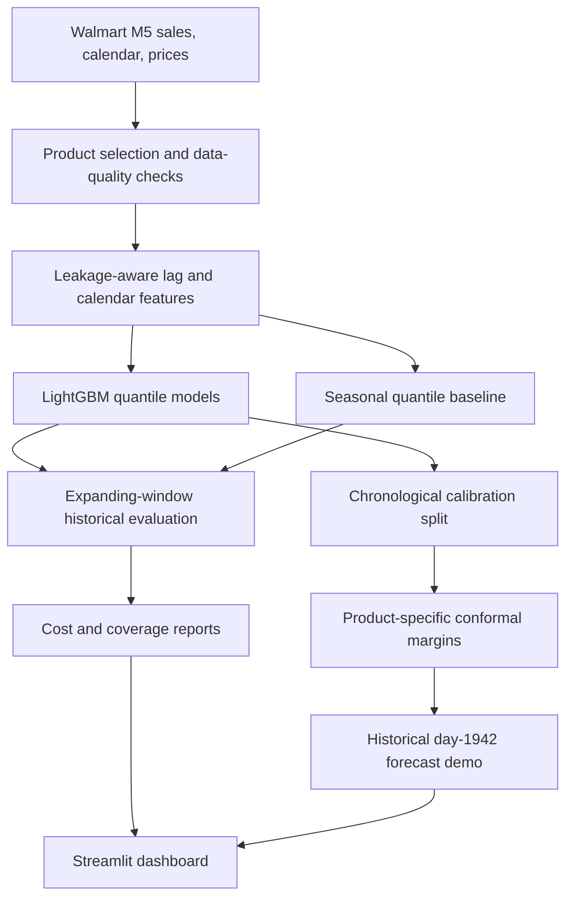

# ForecastGuard

**Uncertainty-aware retail sales forecasting and cost-sensitive inventory decisions**  
Python · LightGBM · Quantile Regression · Conformal Calibration · Streamlit

> **Research prototype, not a live Walmart forecasting service.** Results are historical simulations on selected Walmart M5 sales series. The inventory-cost parameters are hypothetical; reported savings are not verified retailer savings.

ForecastGuard forecasts next-day product-level unit sales, estimates predictive uncertainty, and translates estimated demand quantiles into illustrative order-up-to targets. The project focuses on whether a model improves **decisions**, not just conventional point-forecast accuracy.

**Portfolio demo:** [Add the deployed URL after deployment]  
**Project screenshot:** Add a screenshot from the dashboard to `docs/dashboard-preview.png`, after checking that it contains no local paths or personal information.

## Results at a glance

| Evaluation | Finding |
|---|---:|
| Evaluated products | 5 Walmart M5 food products, store `CA_1` |
| Expanding-window cost backtests | 8 × 56 days; 2,240 product-day predictions |
| Seasonal Q80 baseline simulated cost | $112,278 |
| Price-filtered pooled Q80 model simulated cost | $87,976 |
| **Relative simulated cost reduction** | **21.64%** |
| Folds with lower ML cost | 7 of 8 |
| Historical raw 90% interval coverage | 87.19% |
| Historical calibrated interval coverage | 91.29% |
| Mean interval width, raw → calibrated | 38.7 → 44.7 units |

These results were produced during iterative development, including repeated inspection of evaluation windows. Treat them as exploratory historical evidence, **not** a blind test or an estimate of future profit. The 21.64% figure is relative to the matching seasonal-quantile baseline using a **$2/unit surplus penalty** and an **$8/unit shortage penalty**.

## Why this project exists

A point prediction alone does not tell an inventory planner whether it is preferable to risk a stockout or carry extra units. For a simplified single-period newsvendor decision, if the shortage penalty is $8/unit and the surplus penalty is $2/unit, the cost-optimal target is the **80th percentile of demand**, assuming the forecast distribution is correctly estimated.

ForecastGuard evaluates:

1. Historical sales-only baselines versus a pooled quantile LightGBM model.
2. Asymmetric inventory costs across multiple chronological folds.
3. Prediction-interval coverage and conformalized quantile interval widths.
4. Data-quality and availability proxies, including missing sell-price records and extended zero-sales runs.
5. Model portability through saved pipelines, reproducible Python modules, and automated tests.

## System architecture



## Dataset and experimental design

- Source: [M5 Forecasting – Accuracy, Kaggle](https://www.kaggle.com/c/m5-forecasting-accuracy/data), associated with the M5 forecasting competitions.
- Scope: the five highest-volume `CA_1` food products based on sales available through day 1493: `FOODS_3_090`, `FOODS_3_120`, `FOODS_3_252`, `FOODS_3_586`, `FOODS_3_714`.
- Model inputs: product ID, lagged sales (1/7/14/28 days), trailing means (7/28 days), weekday, month, and known calendar events.
- Model objective: LightGBM quantile regression; main order-policy experiment uses the 80th percentile.
- Backtest folds: expanding training cutoffs 1493, 1549, 1605, 1661, 1717, 1773, 1829, 1885; each evaluated over the following 56 days. The procedure assumes daily updating with the preceding day's *observed* sales available.
- Training policy: observations lacking sell-price records are excluded as targets in the price-filtered variant; lag features still use historical observed sales.
- Baseline: for each product and date, empirical 80th percentile of the previous eight matching weekdays.
- Business objective: `2 × max(order - sales, 0) + 8 × max(sales - order, 0)` per product-day (hypothetical cost units displayed as USD).

### Interpreting uncertainty

Separate 5th- and 95th-percentile models provide a nominal 90% interval. Chronologically held-out data supports **per-product conformal margins**. In a historical rolling evaluation, empirical coverage moved from 87.19% to 91.29%, while mean width increased from 38.7 to 44.7 units. Because demand time series may be non-exchangeable, these measurements do not guarantee future coverage.

The saved calibrated example uses historical M5 **training days 1–1885, calibration days 1886–1941, and forecast day 1942 (2016-05-23)**. It is not a live 2026 prediction. The Q80 order target does not change when only the 90% interval boundaries are calibrated.

## Repository layout

```text
app/             Streamlit dashboard and reliability views
src/             Data pipeline, ML training, inference, inventory costs, evaluation
scripts/         Experiment, calibration, release-audit, and export commands
tests/           Unit and regression tests
notebooks/       Exploratory experiments and investigations
docs/            Technical report, model card, and publication checklist
public_demo/     Standalone aggregated-results overview (no raw M5 records)
data/            LOCAL ONLY — do not publish until usage terms reviewed
models/          LOCAL ONLY — fitted serialized artifacts
results/         LOCAL ONLY — row-level historical forecasts/exports
```

## Local research setup

The original raw files must be obtained under the dataset's applicable competition rules. This repository does **not** redistribute them. Put `calendar.csv`, `sales_train_evaluation.csv`, and `sell_prices.csv` in `data/raw/`. Run the product-extraction notebook (`05_Product_Level_Forecasting.ipynb`) to create `data/selected_product_sales.csv` before using the reusable pipeline.

Create an environment and install the project dependencies (see `requirements-research.example.txt` for an example; lock your tested versions before publication), then execute:

```powershell
python -m pytest -q
python -m scripts.audit_release
python -m streamlit run app/dashboard.py
```

Other reproducible commands from the project:

```powershell
python -m scripts.train_final_model
python -m scripts.predict_next_day
python -m scripts.train_calibrated_bundle
python -m scripts.predict_calibrated_next_day
python -m scripts.run_interval_backtest
```

The release audit requires locally generated output CSVs. The main dashboard also depends on the results files; it will **not** run from a code-only public GitHub checkout without those inputs. The standalone `public_demo/` companion deliberately shows only explicitly disclosed aggregate findings and is not the full data-explorer app.

## Known limitations

- Observed sales are **not** unconstrained customer demand. Long zero-sales streaks may reflect assortment changes or stockouts; price availability does not prove physical stock.
- The cost simulation does not model inventory on hand, replenishment lead time, perishability, returns, supplier constraints, or substitution between products.
- Five high-volume items are a narrow, selectively chosen cohort, not a representative random sample of Walmart products.
- Model and metric choices developed while historical validation windows were inspected; additional prospective or truly held-out evaluation would be required for stronger generalization claims.
- Forecasting is one-day-ahead, conditional on observing recent actual sales; it is not an entire 56-day forecast issued at once.
- Historical conformal coverage is an empirical result under possible distribution shift, not a universal finite-sample guarantee for time series.
- Model artifacts serialized with `joblib` should only be loaded from trusted sources.

## Publication and data permissions

The M5 Kaggle dataset page describes its license as **“Subject to Competition Rules.”** Do not commit the raw files or per-product/day exported data until you have explicitly reviewed the relevant rules and redistribution rights. The default `.gitignore` excludes raw data, row-level CSVs, saved model artifacts, and secrets. See [`docs/PUBLICATION_CHECKLIST.md`](docs/PUBLICATION_CHECKLIST.md).

## Further documentation

- [Technical methodology and results](docs/TECHNICAL_REPORT.md)
- [Model card](docs/MODEL_CARD.md)
- [Publication and deployment checklist](docs/PUBLICATION_CHECKLIST.md)

## Status

**Completed locally:** feature pipeline, quantile forecasts, inventory simulation, rolling backtests, per-product interval calibration, tests, and six-tab Streamlit dashboard.  
**Release verification pending:** the user has not yet provided Phase 17 audit output or an independently checked public deployment result.  
**Public hosting:** not claimed until a deployed URL is tested.
